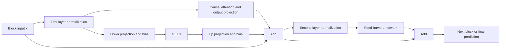

# Test adapter copy

`test_adapter_copy.cu` is the commented teaching copy of the native CUDA trainer.
The source `train_adapter.cu` was left unchanged during creation of this copy.
The copy shares the existing `llmc` headers, so keep it in this directory.

The opening block explains GPT-2, the parallel adapter path, shapes, parameter
count, loss and gradient basics. It expands the supplied Mermaid diagram with
the second layer normalization, feed-forward network and residual sum. Local
comments explain the main routines and important instructions without first
person. The intended tone is conversational and direct, using the supplied
writing example. The dialogue research informed short spoken-style phrases
and sparing use of filler:
https://www.writersdigest.com/on-writing-lifelike-dialogue

The actual forward architecture is:



## Build and forward check in WSL

```bash
cd /home/kroix/projects/SAGE_Adapter_Experiment/llmc-gpt2
bash build_test_adapter_copy.sh
bash smoke_test_adapter_copy.sh
```

The executable is `build/test_adapter_copy/test_adapter_copy`.
The build selects CUDA 12.8, FP32 and the RTX 3080's sm_86 architecture explicitly.
The forward check uses `-x 0` and never updates weights or writes checkpoints.

## Reading the reports

Illustrative report (not a measurement from the real model):

```text
Step 5 of 10 had validation loss 4.000000 nats/token; loss relative to first validation: 80.00% (step 0 reference: 5.000000).
```

Cross-entropy has no inherent percentage scale. The displayed percentage is
`100 * current_loss / first_loss_of_this_type`: 80% means 20% lower loss than
the reference, and 120% means 20% higher. It is not token error rate or accuracy.
Training and validation keep separate references. A restarted/resumed process
starts new display references. Invalid losses and zero denominators show n/a.
Raw numeric loss and the existing logger's data fields remain available.

Validation step 0 precedes updates; validation at step 5 follows five optimizer
loop iterations. Outlier rules may skip an update in an iteration. Training
step 5 reports the batch loss measured before that iteration's update. It can
therefore differ from the validation loss subsequently measured at step 5.
Validation compares the same prefix, with `-m` controlling its batch count.
`-v` controls the interval; final validation still runs at the end.

The readable step details retain gradient norm, learning rate, duration and
throughput. GPU utilization reports the actual selected numeric precision and
shows unavailable when this GPU has no valid peak estimate. Zero/one-step runs
show an unavailable post-warmup time instead of dividing by zero or reporting
a negative zero. These are display changes; the loss calculation is unchanged.

## Verification completed

- Native CUDA compilation passed, with inherited unused-variable warnings.
- Adapter-enabled, forward-only GPU validation returned 5.151681, matching the
  original CUDA trainer on the same checkpoint and input.
- A separate two-step base-model-only run exercised both training and validation
  reporting. Validation changed from 5.151681 to 3.886371 (75.44% of reference).
  This small run tests reporting, not model quality or adapter training.
- Reporting checks cover initial references, decreases, increases, separate
  phases, zero loss/reference, NaN, infinity, negative values and step labels.
- Final comment refinements preserved all executable tokens. The original
  trainer's source hash and existing trained adapter export were unchanged.

Logs, checks and hashes are in `build/test_adapter_copy/`.

## Inherited training limitations

The adapter optimizer still aliases moment/master state between parameter
groups. The adapter backward path still overwrites live residual gradients
and joins C-wide adapter gradients before the 3*C QKV projection. Comments mark
these defects. Adapter gradient clipping also uses the inherited base-gradient
norm rather than the separate adapter gradients. These mathematics were not
changed as part of the requested commenting/reporting edits. Full adapter
training remains unverified.
